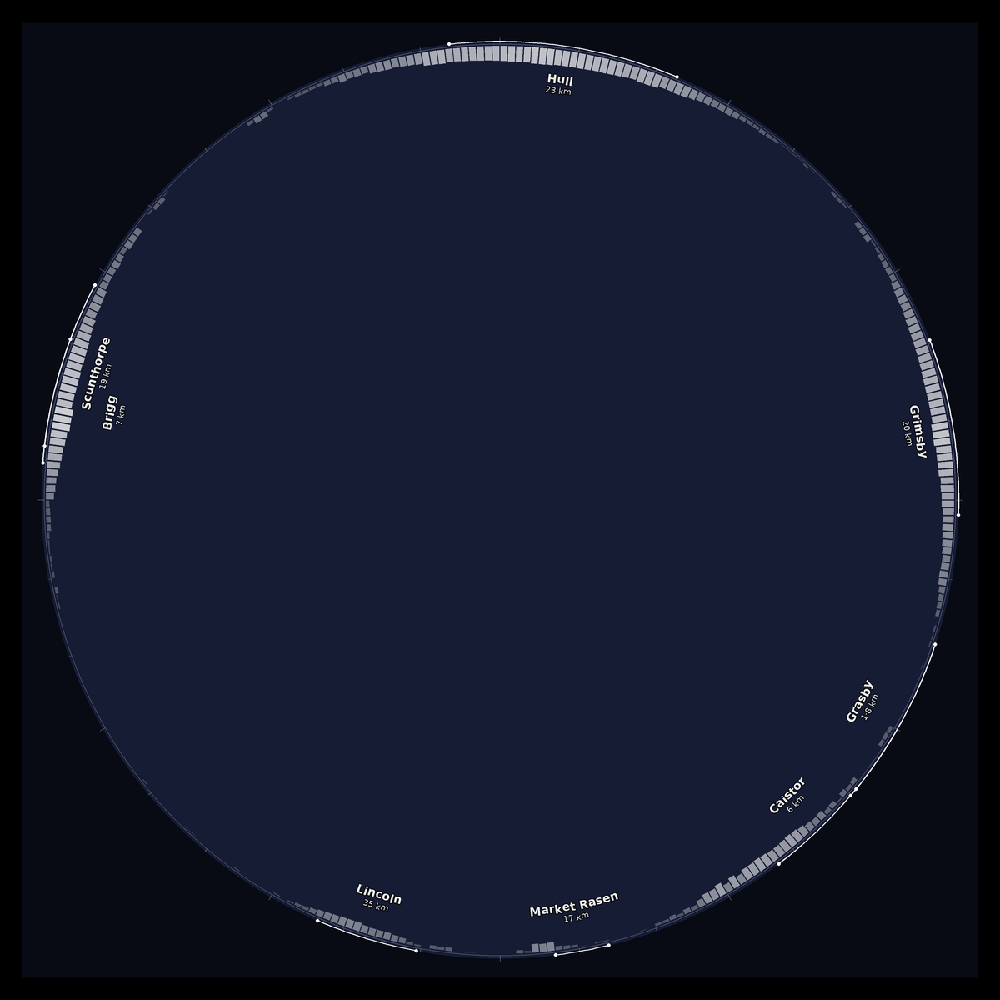

# allsky-horizon-overlay

Tools for an [indi-allsky](https://github.com/aaronwmorris/indi-allsky) camera that
label the horizon with nearby towns and show **where the light pollution comes from**.



*Example output (synthetic background and test data). Each white arc marks a town's
angular width at its bearing; the bars inside the rim show measured light per degree
of azimuth from VIIRS satellite data.*

Built for a ZWO ASI676MC with a 2.5 mm f/2 fisheye on a Raspberry Pi 5 at Searby,
Lincolnshire (53.538 N, 0.383 W). Site and lens values are constants at the top of
each script — change them for another setup.

---

## Contents

| File | Runs on | Purpose |
|---|---|---|
| `horizon_overlay.py` | Pi | Generates `horizon_overlay.png`: town arcs, curved labels, azimuth bezel, optional light-pollution bars |
| `viirs_profile.py` | Desktop / server | Turns a VIIRS night-lights GeoTIFF into `profile.csv` — light reaching the site per degree of azimuth |
| `find_circle.py` | Pi | Measures the fisheye image circle (centre and diameter) in a real frame |
| `apply_config.sh` | Pi | Applies `config/allsky-patch.jq` to the live indi-allsky config: backup, diff, load, restart, check |
| `detection_mask.py` | Pi | Generates `detection_mask.png`: sky above a chosen altitude, for detection and exposure metering |
| `config/allsky-patch.jq` | Pi | The indi-allsky settings this setup depends on, as a jq patch |

---

## How it fits together

```
 VIIRS GeoTIFF ──► viirs_profile.py ──► profile.csv ─┐
                                                     ├─► horizon_overlay.py ──► horizon_overlay.png
 town list + site + lens constants ──────────────────┘                                 │
                                                                                       ▼
 real frame ──► find_circle.py ──► lens values ──► config/allsky-patch.jq ──► apply_config.sh
                                                    (crop, border, mask, LOGO_OVERLAY)
```

indi-allsky's processing order matters:

1. capture → **flip** (`IMAGE_FLIP_H/V`)
2. **crop** (`IMAGE_CROP_ROI`) — coordinates are in the *flipped* image
3. **circle mask** and **logo overlay** — the overlay PNG must match the *cropped* size
4. **border** (`IMAGE_BORDER`) added last

So the overlay canvas is the crop size (3456 × 3456 here), not the final frame
(3616 × 3616 with an 80 px border). indi-allsky logs
`Logo Overlay dimensions do not match image` if they differ.

---

## Requirements

On the Pi, `pillow` and `numpy` are already in indi-allsky's virtualenv.

For `viirs_profile.py`, use a virtual environment on a desktop or server:

```bash
sudo apt install python3-venv
python3 -m venv ~/venvs/viirs
source ~/venvs/viirs/bin/activate
pip install -r requirements.txt
```

`apply_config.sh` needs `jq` (`sudo apt install jq`).

---

## 1. Measure the image circle

Use a bright daytime frame copied straight from the Pi (not saved from the browser,
which may be downscaled):

```bash
python3 find_circle.py /var/www/html/allsky/images/latest.jpg
```

It scans 720 rays outward to find the rim, fits a circle with outlier rejection
(so text labels, overlay graphics and dim patches don't skew it), and writes
`circle_check.png` — red is the fitted circle, green the rim points it trusted.
Check the red circle sits on the rim all the way round.

## 2. Centre the circle with a crop

Work in the flipped image's coordinates. With centre `(cx, cy)` and radius `r`
measured on the **uncropped** frame:

- The largest square centred on the circle has half-width
  `h = min(cx, cy, W − cx, H − cy)`.
- `IMAGE_CROP_ROI = [cx − h, cy − h, cx + h, cy + h]` — round to **even** numbers,
  keeping width = height.
- Margin around the circle inside the crop is `h − r`. If you need more room,
  add an equal `IMAGE_BORDER` on all four sides.

Put the values in `config/allsky-patch.jq`, then apply them (step 3) and re-run
`find_circle.py`: the centre should be within a few pixels of the frame centre.

## 3. Apply indi-allsky settings

```bash
./apply_config.sh --dry-run    # show the diff only
./apply_config.sh              # backup, apply, restart, wait, check the circle
```

The script:

1. dumps the live config to `~/allsky-config/config-<timestamp>-before.json`
2. applies `config/allsky-patch.jq` and shows a diff
3. asks for confirmation, then loads it with `config.py load -c <file> --force`
4. restarts indi-allsky (`systemctl --user restart indi-allsky`)
5. waits 60 s and runs `find_circle.py` on the newest frame

To undo, it prints the reload command for the backup. indi-allsky also keeps
config history: `./config.py list`, then `./config.py revert -i <id>`.

> **The dumps contain passwords and API keys in plain text.** They're written
> owner-only and are git-ignored — never commit or share them. Always load a full
> dump: a redacted copy would wipe your credentials.

In this version of `config.py`, **`-c` is the config file** and **`-i` is a config
ID** — easy to mix up.

## 4. Build the light-pollution profile (optional)

1. Register (free) at the [Earth Observation Group](https://eogdata.mines.edu/register/),
   Colorado School of Mines. Approval takes 1–2 days.
2. From the [VNL products page](https://eogdata.mines.edu/products/vnl/), open
   **Annual VNL V2 → Go to Download V2.2**, choose the most recent year, and download
   the file whose name contains **`average_masked`** and ends **`.dat.tif.gz`**.
3. Unzip and run:

   ```bash
   gunzip VNL_*average_masked.dat.tif.gz
   python3 viirs_profile.py VNL_*average_masked.dat.tif
   ```

The script only reads a window around the site, so the global file works directly.
Optionally crop it first to save disk space:

```bash
gdal_translate -projwin -1.35 54.15 0.60 52.95 VNL_*average_masked.dat.tif lincs_viirs.tif
```

**How it's calculated:** every pixel within `RADIUS_KM` (60) contributes
`radiance × distance^−2.5` (Walker's law for sky glow) to its 1° bearing bin.
Pixels closer than `MIN_KM` (1) are skipped so your own lights don't dominate.
The result is smoothed over 3° and log-scaled to 0–1 for display; the quietest
quarter of directions shows no bar.

> **LED caveat:** VIIRS is largely blind below ~500 nm, so white LED lighting
> reads dimmer from orbit than from the ground. Directions are right; relative
> strengths are approximate. Compare against your own moonless frames.

Copy `profile.csv` to the Pi.

## 5. Generate the overlay

Edit the constants at the top of `horizon_overlay.py`:

| Constant | Value here | Notes |
|---|---|---|
| `SITE_LAT`, `SITE_LON` | 53.538, −0.383 | Camera location |
| `IMG_W`, `IMG_H` | 3456 | **Crop size**, before the border |
| `LENS_IMAGE_CIRCLE` | 3316 | From `find_circle.py` |
| `LENS_FOV` | 181.5 | Full field of view, degrees |
| `LENS_OFFSET_X/Y` | 0, 0 | Circle centre offset within the crop |
| `ROT` | calibrate | Rotation, degrees clockwise on screen |
| `EAST_LEFT` | `False` | Matches indi-allsky's cardinals with both flips on |
| `LABELS_INSIDE` | `True` | Labels inside the rim; set `False` if there's ~130 px of margin outside |
| `TOWNS` | list | `(name, lat, lon, width_km, population)` |

`width_km` sets the arc length (`2·atan(width/2 / distance)`); `population` only
decides which labels get first pick of a ring when they'd collide.

```bash
python3 horizon_overlay.py --profile profile.csv
file horizon_overlay.png     # expect: 3456 x 3456 ... RGBA
```

Leave out `--profile` for town arcs only.

### Calibrating `ROT` and `EAST_LEFT`

On a clear night:

```bash
python3 horizon_overlay.py --cardinals --profile profile.csv \
  --preview <night frame or star-trails image>
sudo cp preview.png /var/www/html/allsky/preview.png   # view in a browser
```

Find Polaris (azimuth 0°) — in a star-trails image it's the centre of the circles.
Read its pixel position `(x, y)` and convert to an angle:

```bash
python3 -c "import math; x,y=1520,960; c=1728; print(round(math.degrees(math.atan2(x-c, c-y)),1))"
```

(`c` is half the crop size.) Set `ROT` to that value so the blue **N** marker
lands on Polaris. Check east/west with the Moon or a planet rising; flip
`EAST_LEFT` if they're mirrored. Re-run without `--cardinals` when done.

## 6. Install

```bash
sudo cp horizon_overlay.png /var/lib/indi-allsky/horizon_overlay.png
systemctl --user restart indi-allsky
```

`LOGO_OVERLAY` is set by `config/allsky-patch.jq`. After any change to towns,
`ROT`, lens values or the profile, regenerate, copy and restart.

The PNG must be **RGBA** — transparent background with per-element alpha
(arcs 255, bezel ~100, bars 40–200). If an editor flattens it to RGB, the
overlay will black out the sky.

## 7. Detection / metering mask (optional)

`detection_mask.py` writes a black-and-white PNG (white = use, black = ignore)
covering the sky above `MIN_ALT` (default 20°), with optional extra exclusions
for obstructions via `SECTORS = [(az_from, az_to, min_alt), ...]`. indi-allsky
uses it for star/meteor detection and to measure image brightness, so streetlights
and lit low cloud near the horizon don't skew the exposure.

```bash
python3 detection_mask.py --preview <full-size frame>   # red = ignored
sudo cp detection_mask.png /var/lib/indi-allsky/detection_mask.png
```

Then uncomment the `DETECT_MASK` line in `config/allsky-patch.jq` and apply.
Uses the same geometry constants (and `ROT`, `EAST_LEFT`) as `horizon_overlay.py`.

---

## Troubleshooting

| Symptom | Cause / fix |
|---|---|
| `Logo Overlay dimensions do not match image` | `IMG_W/H` must equal the **crop** size, not the final frame |
| Labels cut off at the edge | Not enough margin in the crop; keep `LABELS_INSIDE = True` |
| Overlay mirrored (east on the wrong side) | Toggle `EAST_LEFT` |
| Arcs/ticks outside the rim disappear | Circle mask drawn over them — raise `IMAGE_CIRCLE_MASK.DIAMETER` |
| `find_circle.py` width ≠ height | Rim detection failed; use the current version (radial scan) and check `circle_check.png` |
| Crop values rejected | All four `IMAGE_CROP_ROI` values must be even |
