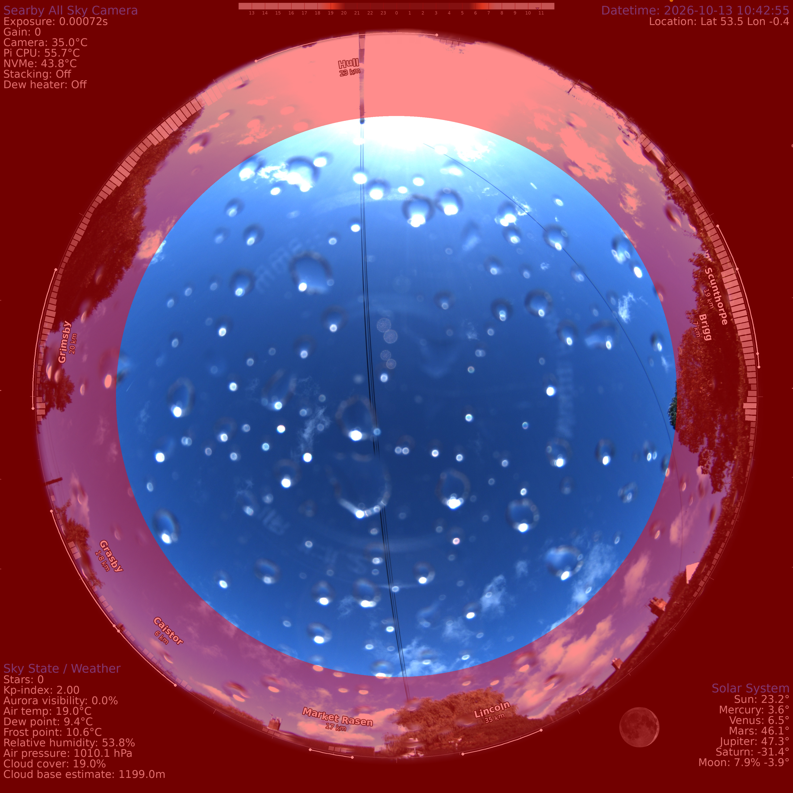

# allsky-horizon-overlay

Tools for an [indi-allsky](https://github.com/aaronwmorris/indi-allsky) camera that
label the horizon with nearby towns and show **where the light pollution comes from**.


*Example output (synthetic background and test data). Each white arc marks a town's
angular width at its bearing; the bars inside the rim show measured light per degree
of azimuth from VIIRS satellite data.*

Built for a ZWO ASI676MC with a 2.5 mm f/2 fisheye on a Raspberry Pi 5 at Searby,
Lincolnshire (53.538 N, 0.383 W). All site, lens and geometry values live in one
shared settings file, `site.toml` — change them there for another setup.

---

## Contents

| File | Runs on | Purpose |
|---|---|---|
| `site.example.toml` | — | Shared settings template: site, lens, orientation, frame sizes, towns, mask, VIIRS. Copy to `site.toml` |
| `allsky_site.py` | — | Loads `site.toml` for the three scripts below |
| `horizon_overlay.py` | Pi | Generates `horizon_overlay.png`: town arcs, curved labels, azimuth bezel, optional light-pollution bars |
| `viirs_profile.py` | Desktop / server | Turns a VIIRS night-lights GeoTIFF into `profile.csv` — light reaching the site per degree of azimuth |
| `find_circle.py` | Pi | Measures the fisheye image circle (centre and diameter) in a real frame |
| `apply_config.sh` | Pi | Applies `config/allsky-patch.jq` to the live indi-allsky config: backup, diff, load, restart, check |
| `detection_mask.py` | Pi | Generates `detection_mask.png` (full sensor size): sky above a chosen altitude, for detection, SQM and exposure metering |
| `config/allsky-patch.jq` | Pi | The indi-allsky settings this setup depends on, as a jq patch |

---

## How it fits together

```
 VIIRS GeoTIFF ──► viirs_profile.py ──► profile.csv ─┐
                                                     ├─► horizon_overlay.py ──► horizon_overlay.png
 site.toml (site, lens, towns) ──────────────────────┘                                 │
                                                                                       ▼
 real frame ──► find_circle.py ──► lens values ──► config/allsky-patch.jq ──► apply_config.sh
                                                    (crop, border, mask, LOGO_OVERLAY)
```

indi-allsky's processing order matters:

1. capture → **flip** (`IMAGE_FLIP_H/V`)
2. **crop** (`IMAGE_CROP_ROI`) — coordinates are in the *flipped* image
3. **circle mask** and **logo overlay** — the overlay PNG must match the *cropped* size
4. **border** (`IMAGE_BORDER`) added last

So the overlay canvas is the crop size (3456 × 3456 here), not the final frame
(3616 × 3616 with an 80 px border). indi-allsky logs
`Logo Overlay dimensions do not match image` if they differ.

---

## Requirements

On the Pi, `pillow` and `numpy` are already in indi-allsky's virtualenv.

For `viirs_profile.py`, use a virtual environment on a desktop or server:

```bash
sudo apt install python3-venv
python3 -m venv ~/venvs/viirs
source ~/venvs/viirs/bin/activate
pip install -r requirements.txt
```

`apply_config.sh` needs `jq` (`sudo apt install jq`).

---

## Settings: `site.toml`

`horizon_overlay.py`, `detection_mask.py` and `viirs_profile.py` share one
settings file, so the lens, orientation and location are defined once.

```bash
cp site.example.toml site.toml      # then edit site.toml
```

`site.toml` is git-ignored, so your own values stay local. If it's missing,
the scripts fall back to `site.example.toml` and print a note. To use a
different file: `ALLSKY_SITE=/path/to/file.toml python3 horizon_overlay.py`.

| Section | Keys | Used by |
|---|---|---|
| `[site]` | `name`, `latitude`, `longitude` | overlay, VIIRS |
| `[lens]` | `image_circle` (px), `fov` (°) | overlay, mask |
| `[orientation]` | `rot` (°, clockwise), `east_left` | overlay, mask sectors |
| `[frame.cropped]` | `width`, `height`, `offset_x`, `offset_y` | overlay — must equal the **crop** size |
| `[frame.full]` | `width`, `height`, `offset_x`, `offset_y` | mask — the **full, uncropped** sensor frame |
| `[overlay]` | `labels_inside`, `towns` | overlay |
| `[mask]` | `min_alt`, `sectors` | mask |
| `[viirs]` | `radius_km`, `min_km`, `walker_exp`, `smooth_deg` | VIIRS |

The two `[frame.*]` sections exist because indi-allsky applies the logo overlay
**after** `IMAGE_CROP_ROI` but uses the detection mask **before** it.

Requires Python 3.11+ (for `tomllib`); on older Python, `pip install tomli`.
Styling (colours, fonts, label sizes, bar lengths) stays in `horizon_overlay.py`.

---

## 1. Measure the image circle

Use a bright daytime frame copied straight from the Pi (not saved from the browser,
which may be downscaled):

```bash
python3 find_circle.py /var/www/html/allsky/images/latest.jpg
```

It scans 720 rays outward to find the rim, fits a circle with outlier rejection
(so text labels, overlay graphics and dim patches don't skew it), and writes
`circle_check.png` — red is the fitted circle, green the rim points it trusted.
Check the red circle sits on the rim all the way round.

## 2. Centre the circle with a crop

Work in the flipped image's coordinates. With centre `(cx, cy)` and radius `r`
measured on the **uncropped** frame:

- The largest square centred on the circle has half-width
  `h = min(cx, cy, W − cx, H − cy)`.
- `IMAGE_CROP_ROI = [cx − h, cy − h, cx + h, cy + h]` — round to **even** numbers,
  keeping width = height.
- Margin around the circle inside the crop is `h − r`. If you need more room,
  add an equal `IMAGE_BORDER` on all four sides.

Put the values in `config/allsky-patch.jq`, then apply them (step 3) and re-run
`find_circle.py`: the centre should be within a few pixels of the frame centre.

## 3. Apply indi-allsky settings

```bash
./apply_config.sh --dry-run    # show the diff only
./apply_config.sh              # backup, apply, restart, wait, check the circle
```

The script:

1. dumps the live config to `~/allsky-config/config-<timestamp>-before.json`
2. applies `config/allsky-patch.jq` and shows a diff
3. asks for confirmation, then loads it with `config.py load -c <file> --force`
4. restarts indi-allsky (`systemctl --user restart indi-allsky`)
5. waits 60 s and runs `find_circle.py` on the newest frame
omv.searby.space
To undo, it prints the reload command for the backup. indi-allsky also keeps
config history: `./config.py list`, then `./config.py revert -i <id>`.

> **The dumps contain passwords and API keys in plain text.** They're written
> owner-only and are git-ignored — never commit or share them. Always load a full
> dump: a redacted copy would wipe your credentials.

In this version of `config.py`, **`-c` is the config file** and **`-i` is a config
ID** — easy to mix up.

## 4. Build the light-pollution profile (optional)

1. Register (free) at the [Earth Observation Group](https://eogdata.mines.edu/register/),
   Colorado School of Mines. Approval takes 1–2 days.
2. From the [VNL products page](https://eogdata.mines.edu/products/vnl/), open
   **Annual VNL V2 → Go to Download V2.2**, choose the most recent year, and download
   the file whose name contains **`average_masked`** and ends **`.dat.tif.gz`**.
3. Unzip and run:

   ```bash
   gunzip VNL_*average_masked.dat.tif.gz
   python3 viirs_profile.py VNL_*average_masked.dat.tif
   ```

Run it from a clone of this repo — it reads the site location and `[viirs]`
settings from `site.toml` via `allsky_site.py`.

The script only reads a window around the site, so the global file works directly.
Optionally crop it first to save disk space:

```bash
gdal_translate -projwin -1.35 54.15 0.60 52.95 VNL_*average_masked.dat.tif lincs_viirs.tif
```

**How it's calculated:** every pixel within `radius_km` (60) contributes
`radiance × distance^−2.5` (Walker's law for sky glow) to its 1° bearing bin.
Pixels closer than `min_km` (1) are skipped so your own lights don't dominate.
The result is smoothed over `smooth_deg` (3°) and log-scaled to 0–1 for display; the quietest
quarter of directions shows no bar.

> **LED caveat:** VIIRS is largely blind below ~500 nm, so white LED lighting
> reads dimmer from orbit than from the ground. Directions are right; relative
> strengths are approximate. Compare against your own moonless frames.

Copy `profile.csv` to the Pi.

## 5. Generate the overlay

Settings come from `site.toml`:

| Setting | Value here | Notes |
|---|---|---|
| `[site]` `latitude`, `longitude` | 53.538, −0.383 | Camera location |
| `[frame.cropped]` `width`, `height` | 3456 | **Crop size**, before the border |
| `[frame.cropped]` `offset_x`, `offset_y` | 0, 0 | Circle centre offset within the crop |
| `[lens]` `image_circle` | 3316 | From `find_circle.py` |
| `[lens]` `fov` | 181.5 | Full field of view, degrees |
| `[orientation]` `rot` | calibrate | Rotation, degrees clockwise on screen |
| `[orientation]` `east_left` | `false` | Matches indi-allsky's cardinals with both flips on |
| `[overlay]` `labels_inside` | `true` | Labels inside the rim; `false` needs ~130 px of margin outside |
| `[overlay]` `towns` | list | `{ name, lat, lon, width_km, population }` per town |

`width_km` sets the arc length (`2·atan(width/2 / distance)`); `population` only
decides which labels get first pick of a ring when they'd collide.

```bash
python3 horizon_overlay.py --profile profile.csv
file horizon_overlay.png     # expect: 3456 x 3456 ... RGBA
```

Leave out `--profile` for town arcs only.

### Calibrating `rot` and `east_left`

On a clear night:

```bash
python3 horizon_overlay.py --cardinals --profile profile.csv \
  --preview <night frame or star-trails image>
sudo cp preview.png /var/www/html/allsky/preview.png   # view in a browser
```

Find Polaris (azimuth 0°) — in a star-trails image it's the centre of the circles.
Read its pixel position `(x, y)` and convert to an angle:

```bash
python3 -c "import math; x,y=1520,960; c=1728; print(round(math.degrees(math.atan2(x-c, c-y)),1))"
```

(`c` is half the crop size.) Set `rot` in `site.toml` to that value so the blue **N** marker
lands on Polaris. Check east/west with the Moon or a planet rising; flip
`east_left` if they're mirrored. Re-run without `--cardinals` when done.

## 6. Install

```bash
sudo cp horizon_overlay.png /var/lib/indi-allsky/horizon_overlay.png
systemctl --user restart indi-allsky
```

`LOGO_OVERLAY` is set by `config/allsky-patch.jq`. After any change to towns,
`rot`, lens values or the profile, regenerate, copy and restart.

The PNG must be **RGBA** — transparent background with per-element alpha
(arcs 255, bezel ~100, bars 40–200). If an editor flattens it to RGB, the
overlay will black out the sky.

## 7. Detection / metering mask (optional)



*Example mask preview from running the script with the `--preview` option.*

`detection_mask.py` writes `detection_mask.png`: a black-and-white image where
**white = use** and **black = ignore**. indi-allsky uses it for star and meteor
detection, SQM, and measuring image brightness, so streetlights, house lights and
lit low cloud near the horizon don't skew the exposure.

> **The mask must match the full, uncropped sensor frame (3552 × 3552)** — not
> the cropped size used by the logo overlay. indi-allsky applies it in the SQM
> calculation *before* `IMAGE_CROP_ROI`. A mask at the cropped size crashes the
> image worker on every frame, so no images are saved:
>
> ```
> cv2.error: ... (-209:Sizes of input arguments do not match) ... 'binary_op'
> ```

### Where the geometry comes from

The script does **not** read image sizes from a frame. Everything comes from
`site.toml`:

| Setting | Value here | Meaning |
|---|---|---|
| `[frame.full]` `width`, `height` | 3552 | Mask size — the **full sensor frame**, uncropped |
| `[frame.full]` `offset_x`, `offset_y` | 0, 0 | Circle centre offset — deliberately 0, see below |
| `[lens]` `image_circle` | 3316 | Image circle diameter, px (shared with the overlay) |
| `[lens]` `fov` | 181.5 | Full field of view, degrees (shared) |
| `[orientation]` `rot`, `east_left` | 0.0, `false` | Shared with the overlay — only used by `sectors` |
| `[mask]` `min_alt` | 20 | Everything below this altitude is ignored |
| `[mask]` `sectors` | `[]` | Extra exclusions: `[az_from, az_to, min_alt]` |

The lens and orientation are shared with the overlay automatically; only the
frame differs, because the overlay is applied after the crop and the mask before it.

**Why the offsets are 0:** in the uncropped frame the circle centre is about
65 px from the middle, but whether that's up-left or down-right depends on
whether indi-allsky applies its flips before or after this stage — not yet
established. The cut-off disc (≈1279 px radius at 20°) sits well inside the
1658 px sky circle, so a 65 px error is harmless for metering and SQM.

### What it does

1. Creates a black canvas `[frame.full]` `width` × `height`.
2. Finds the horizon radius: `(image_circle / 2) × 90 / (fov / 2)`
   — here 1658 × 90 / 90.75 ≈ **1644 px**.
3. Finds the cut-off radius. On an equidistant fisheye, radius is proportional
   to zenith angle: `r = horizon_radius × (90 − min_alt) / 90` — at 20° that's
   1644 × 70 / 90 ≈ **1279 px**.
4. Draws a white disc of that radius — the sky that's used.
5. Blacks out each `sectors` entry from the disc edge inward to its own altitude.
6. Saves `detection_mask.png`.

### Sectors — not yet verified

`sectors` entries such as `[330, 30, 35]` (ignore NNW–NNE below 35°) are drawn
using `rot` and `east_left`. Because the mask is applied before the crop, and
possibly before the flips, a sector may land on the **opposite side of the sky**
(both flips = a 180° rotation; adding 180 to `rot` would correct it). Leave `sectors`
empty until the orientation is confirmed, e.g. with a deliberate test sector and
star detection.

### The `--preview` frame

A rough visual check only: the script tints the ignored area red on a frame and
writes `mask_preview.png`. Saved frames are cropped (3616 × 3616 with border)
while the mask is full-sensor size, so the preview centres one on the other and
ignores the offset — fine for judging `min_alt`, not for exact alignment.

### Steps

```bash
# 1. Generate the mask (and optionally a preview)
python3 detection_mask.py --preview /var/www/html/allsky/images/latest.jpg
file detection_mask.png            # must say 3552 x 3552

# 2. Install
sudo cp detection_mask.png /var/lib/indi-allsky/detection_mask.png
```

3. Set `DETECT_MASK` in `config/allsky-patch.jq`, then
   `./apply_config.sh --dry-run` and `./apply_config.sh`.
4. Confirm the image worker is happy:

   ```bash
   sudo journalctl --since "5 min ago" --no-pager | grep -c 'Image worker exception'   # expect 0
   ```

   If it isn't 0, disable the mask at once (`| .DETECT_MASK = ""` in the patch,
   then apply) — no images are saved while the worker is crashing, and the
   watchdog will start restarting the services.

### Tuning

- **`min_alt`**: 25–30° for a cluttered horizon, 15° for a clear one.
- **`sectors`**: see the warning above before using.

---

## Troubleshooting

| Symptom | Cause / fix |
|---|---|
| `Logo Overlay dimensions do not match image` | `[frame.cropped]` must equal the **crop** size, not the final frame |
| Labels cut off at the edge | Not enough margin in the crop; keep `labels_inside = true` |
| Overlay mirrored (east on the wrong side) | Toggle `east_left` in `site.toml` |
| `Note: site.toml not found` | Using the example values — `cp site.example.toml site.toml` |
| Arcs/ticks outside the rim disappear | Circle mask drawn over them — raise `IMAGE_CIRCLE_MASK.DIAMETER` |
| `find_circle.py` width ≠ height | Rim detection failed; use the current version (radial scan) and check `circle_check.png` |
| Crop values rejected | All four `IMAGE_CROP_ROI` values must be even |
| `Image worker exception` … `Sizes of input arguments do not match` | Detection mask is the wrong size — it must be the **uncropped** 3552 × 3552; disable `DETECT_MASK` until fixed |
